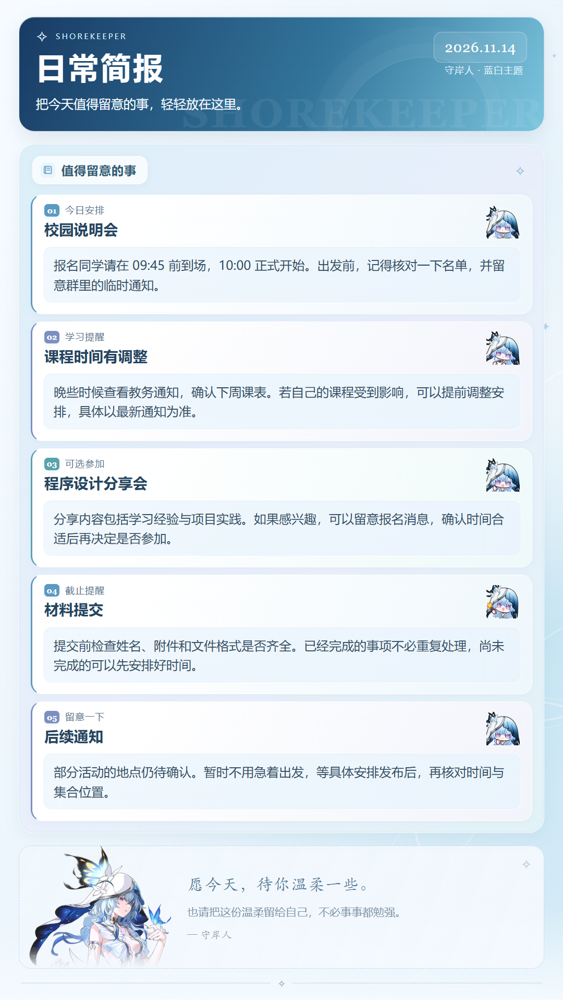
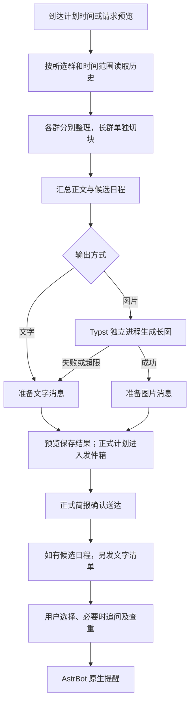

<div align="center">

# 多群每日简报

**把群聊里的重要通知整理成文字或图片，再把你选中的日程加入 AstrBot「未来任务」。**

[](metadata.yaml)
[](https://github.com/AstrBotDevs/AstrBot)
[](#使用前准备)
[](LICENSE)

[快速开始](#快速开始) · [安装与升级](#安装与升级) · [图片与字体](#图片简报与字体) · [配置说明](#配置说明) · [日程提醒](#日程提醒) · [常见问题](#常见问题) · [模板开发](docs/template-spec.md)

</div>

适用于 AstrBot 的多群日报／周报插件。每份任务可以独立选择源群、收件人、总结模型、人格、关注范围、执行时间和输出方式。图片由 **Typst 在本机生成**，不需要浏览器、AI 绘图或远程截图服务。

插件读取 **AstrBot 已保存的群历史**，先按群整理，再汇总重要内容。简报发送到 QQ 私聊；如果有可添加的日程，会另发一条文字清单，由收件人选择是否创建提醒。

> 当前版本 **v0.5.1**：图片渲染已切换为 Typst，守岸人模板已完成服务器出图验证。旧任务仍保持文字输出；需要图片时，在任务的「内容与表达」中手动选择。实际 QQ 图片投递仍待端到端验收。

## 功能概览

| 功能 | 说明 |
| --- | --- |
| 多任务定时简报 | 每日或每周运行，不同任务使用不同群、模型、收件人和时间 |
| 文字／图片输出 | 文字按长度分条；图片由 Typst 模板本地生成，支持网页预览和下载 |
| 按需出图 | 单个独立进程串行编译，完成即退出，不常驻浏览器或编译器 |
| 按群理解消息 | 长消息只在各自群内切块；每批传入群名、群号和平台标识 |
| 人格与关注范围 | 总结正文和日程结果回执使用所选人格；个人背景独立填写，也可留空 |
| 自然语言选日程 | 默认在询问送达后的前 **3 条有效文字消息**中自动识别，不设额外的分钟限制 |
| 多轮补充与查重 | 信息不足先追问；创建前核对已有原生任务，同项复用、存疑询问 |
| 回执与补发 | 保留各条消息的发送状态；未知结果先核对，已成功部分不重复发送 |
| 分区管理页面 | 任务配置、简报预览、执行记录、日程与提醒；提供问号说明、明暗主题及窄屏布局 |

<details>
<summary>查看守岸人图片模板示例</summary>

<p align="center"></p>

示例为虚构内容。模板采用蓝白配色、独立事项卡片、静态 Q 版表情和底部立绘；正文越多，图片自然向下延长。预览中的原版字体不随 GitHub 源码分发，缺少字体时外观可能不同。

</details>

## 使用前准备

- **QQ 接入**：AstrBot 已连接 OneBot v11（`aiocqhttp`），机器人在线且已加入所选群；既有部署使用 NapCat。
- **群历史**：AstrBot 已开启并保留群历史。使用消息白名单时，所选群需要允许记录。
- **总结模型**：AstrBot 中已配置聊天模型及有效的上下文上限。
- **原生提醒**：使用日程功能时，收件人会话的原生模型与消息工具应能执行 AstrBot「未来任务」。
- **图片环境**：选择图片输出时，还需在运行 AstrBot 的设备或容器中准备 Typst 和模板字体，见[图片简报与字体](#图片简报与字体)。

当前支持 **QQ 群作为消息来源、QQ 私聊作为收件人**。尚不支持向群内直接推送，也未适配其他聊天平台。

## 安装与升级

### 安装插件

在 AstrBot WebUI 的插件管理中，通过仓库链接安装：

```text
https://github.com/WinterMoonlight/astrbot_plugin_daily_digest
```

安装后，从插件详情打开「多群每日简报」管理页。页面复用 AstrBot 登录与端口，不需要单独开放插件管理端口。

手动安装时，将源码放入 `data/plugins/astrbot_plugin_daily_digest/`，保留 `digest/`、`views/`、`templates/` 等目录结构。在 **AstrBot 使用的 Python 环境**中、从插件根目录安装依赖，然后重载插件：

```sh
python -m pip install -r requirements.txt
```

正式运行使用 Python，`requirements.txt` 包含 Typst 和清单校验依赖。**不需要安装 Chromium、Playwright、Node.js 或独立 Typst 命令行程序。** Node.js 仅用于可选的素材处理和前端测试。

若要使用图片输出，继续完成[模板字体准备](#模板字体)，并先运行一次不调用模型的[本地样图测试](#先生成一张样图)。

### 从旧版本升级

当前 **v0.5.1 沿用数据库版本 5**。从 v0.4.x 升级时会新增图片投递类型和收尾短句记录；从 v0.5.0 升级无需再次升级数据库。旧任务默认文字输出，已有提示词、日程关联及文字回执保留；更新不会自动替换你填写的总结提示词。

v0.5.1 的图片模板使用 **规范版本 2**，内置守岸人模板版本为 **2.0.0**。旧的 HTML 模板不能直接交给 Typst，需要按[模板规范](docs/template-spec.md)转换。版本号分别描述插件、数据库和模板，请勿混用。

升级前备份插件代码、插件数据目录和各模板的私有字体。运行中的 SQLite 应使用一致性备份，或停机后复制。回退旧代码时也需恢复对应版本的数据库，旧版本不能直接写入版本 5 的数据库。

如果采用整目录替换方式升级，记得将私有字体恢复到新模板的对应目录；只更新 Git 代码不会带回被忽略的字体文件。

## 快速开始

1. 打开管理页，点击「**新建任务**」。
2. 在「**消息与投递**」填写任务名称、选择源群，并填写私聊收件人 UMO。
3. 在「**内容与表达**」选择模型、可选人格和输出方式。使用图片时再选模板；按需填写个人背景与总结提示词。
4. 设置运行频率、时间、回看范围及日程提醒参数，点击「**保存配置**」。新任务默认停用。
5. 到「**简报预览**」点击「**保存并生成预览**」。检查正文或图片，以及「消息覆盖与生成信息」。预览会调用模型，但不发送 QQ 消息、不创建提醒。
6. 回到任务配置，点击「**启用任务**」。从下一个计划时点开始生成，完成后发送；执行结果可在「**执行记录**」查看。

**如何填写会话标识：**让收件人私聊机器人发送 `/sid`，复制返回的完整 UMO，格式为 `平台实例:FriendMessage:QQ号`。群列表不可用时，展开「手动填写群会话标识」，每行填写一个 `平台实例:GroupMessage:群号`。示例中的占位文字需要替换为实际值。

可以把身份和整理要求分开填写，例如：

| 字段 | 示例 |
| --- | --- |
| 个人背景（可选） | 我是这些课程群的学生，希望关注与选课、课程安排和学业要求有关的信息。 |
| 总结提示词 | 优先整理作业、考试、课程调整和报名截止时间。合并重复通知，每件事尽量简短，保留必要的时间、地点和适用条件；群名自然融入叙述。信息不明确时说明待确认，不推断我已报名或承担某项工作。 |

个人背景留空也可运行。无需把某个人格的名字或语气固定写进通用整理要求；人格可在下拉框中选择。

## 图片简报与字体

### 文字和图片如何配合

| 输出方式 | 简报正文 | 日程清单与操作回执 |
| --- | --- | --- |
| 文字 | 按单条长度设置分条发送 | 文字 |
| 图片 | 按所选模板生成 PNG，网页可预览和下载 | 仍为文字，便于回复、引用和选择 |

图片模式在最后一轮总结中同时生成结构化卡片，不额外调用一次模型拆分文章。卡片有效时，图片与备用文字来自同一份内容；结构不合格时，保留模型返回的可用文字稿。

模板与人格分别选择：**人格控制正文表达，模板控制外观和固定装饰文案**。守岸人模板的 10 组收尾寄语按“大字＋小字”成组轮换；预览与正式计划分别记录，同一次执行及补发使用已经选定的组合。

### 准备 Typst

正式图片渲染使用 Typst，不依赖 Chromium、Playwright 或外部截图服务。在运行 AstrBot 的 Python 环境中安装根目录依赖即可：

```sh
python -m pip install -r requirements.txt
```

Docker 部署需在 AstrBot 容器内操作。渲染采用独立子进程，每次生成完成后退出并释放编译器内存；同时只生成一张图。文字模式不会启动 Typst 子进程。

这里的“本地渲染”指在运行 AstrBot 的设备上生成图片。AstrBot 在服务器运行，图片就在服务器生成，截图过程不向外部服务提交群消息。

### 模板字体

每个模板使用自己的字体目录。守岸人原版使用微软雅黑、华文楷体和 Georgia，文件放在：

```text
templates/shorekeeper/assets/fonts/private/
```

这些私有字体 **不包含在 GitHub 仓库中**。本地开发时保留在模板目录；部署到自己的服务器时，再单独复制到服务器上相同的模板目录，无需注册为系统字体。默认文件名如下：

```text
assets/fonts/private/
├── msyh.ttf       # 微软雅黑常规：正文
├── msyhbd.ttf     # 微软雅黑粗体：标题
├── STKAITI.TTF    # 华文楷体：收尾大字与署名
├── georgia.ttf    # Georgia 常规：日期
└── georgiab.ttf   # Georgia 粗体：英文装饰
```

文件名区分大小写。这里的微软雅黑 TTF 为对应字体集合中的单个字面，不能直接把 `.ttc` 改名成 `.ttf`。若使用其他字体，应同时调整模板清单中的字体族与回退列表。具体见[字体说明](templates/shorekeeper/assets/fonts/README.md)及[模板规范](docs/template-spec.md)。

没有原版字体时，模板会尝试声明的回退字体，并在模板选择处和执行记录提示。**所有需要的字体角色都必须有可用字体**：只有中文字体可用，但日期或装饰字体无可用回退，也会转为文字输出。字体变化可能改变字形、换行和图片高度。

字体文件只供有相应使用权限的部署使用；公开分发字体应保留授权说明。不要把私有字体、字体子集或包含它们的安装包提交到 GitHub。

### 先生成一张样图

在插件根目录运行，先检查模板、字体和 Typst 环境：

```sh
python tools/preview_template.py --template shorekeeper
```

默认输出 `.local/template-preview/preview.png`，诊断信息在同目录的 `result.json`。此命令使用虚构样例，不读取群历史、不调用模型、不发送 QQ。Docker 部署应在 AstrBot 容器内运行，才能验证实际服务环境。

### 长图和失败处理

正文越多，图片越长；当前一次输出一张 PNG，不自动分页。当前限制为 **12000px 高、8 MiB**，渲染单并发，单次渲染整体预算为 **90 秒**，其中独立编译进程最多运行 75 秒，超时会终止并回收。

- 模板失效、缺少 Typst 依赖、渲染出错或超过尺寸限制时，回退完整文字，并在执行记录说明原因。
- 图片已经进入发送流程后，发送失败按原有补发机制处理；**结果未知时不会自动再发一份文字**，避免重复打扰。
- 补发复用缓存原图；缓存缺失或校验失败会阻止发送，不会悄悄换成另一张图。

## 配置说明

管理页分为「**任务配置**」「**简报预览**」「**执行记录**」「**日程与提醒**」。字段旁的 `?` 支持悬停、点击和键盘聚焦查看解释，Esc 关闭。

### 每份任务独立设置

| 分区 | 设置 | 默认值或行为 |
| --- | --- | --- |
| 消息与投递 | 名称、来源群、私聊收件人 | 一个或多个群，发送到一个 QQ 私聊 |
| 内容与表达 | 总结模型 | 从 AstrBot 已配置的模型中选择 |
| 内容与表达 | 人格 | 可留空，沿用收件人的 AstrBot 会话人格 |
| 内容与表达 | 输出方式、图片模板 | 默认文字；选择图片时可选模板 |
| 内容与表达 | 个人背景 | 可留空，辅助判断哪些信息与你有关 |
| 内容与表达 | 总结提示词 | 设置关注范围、整理要求、篇幅等 |
| 运行计划 | 执行频率 | 默认每日；每周可选择多个执行日 |
| 运行计划 | 执行时间、时区 | 默认 `08:00`、`Asia/Shanghai`；此时开始生成，不保证此时已送达 |
| 运行计划 | 消息回看时长 | 新建每日任务默认 24 小时，每周默认 168 小时，可修改 |
| 日程提醒 | 默认提前量 | 30 分钟，可为 0；用户本次明确指定的时间优先 |
| 日程提醒 | 候选日期范围 | 今天及随后 6 天内，尚未开始的事项 |
| 日程提醒 | 清单有效期 | 询问成功发送后 24 小时；补选不续期，新清单替换同一任务的旧清单 |

已登记的执行使用当时的配置快照，后续修改用于后续计划。归档和彻底删除入口在配置底部的「任务管理」。

### 全局设置

点击右上角「**全局设置**」，这些选项对所有任务生效。

| 设置 | 默认值 | 说明 |
| --- | --- | --- |
| 同时生成上限 | 1 | 其余任务排队，同一任务仍串行；图片渲染另有单并发限制 |
| 生成超时 | 1200 秒 | 一次生成的整体预算，包含内容生成及图片处理 |
| 生成调用预算 | 64 次 | 分群提取、压缩和最终汇总的逻辑模型调用总数 |
| 单条文字长度 | 1500 字符 | 长文字分条，分条编号也计入；最低 32 字符 |
| 分条发送间隔 | 1 秒 | 两次消息发送之间的等待时间 |
| 执行详情保留 | 30 天 | 清理符合条件的旧详情；待处理业务与必要防重凭据另行保留 |
| 自动识别条数 | 3 条 | 询问全部送达后的有效文字额度，不另设分钟限制 |

参数使用正整数。模型内部重试和备用模型尝试不等同于逻辑调用次数，调用预算也不是固定费用上限。已有询问保留原先剩余条数，新设置用于后续询问。

### 模型与人格的边界

总结正文、日程意图解析和结果回执使用任务模型；备用模型沿用收件人会话对应配置。总结正文与结果回执使用任务选定的人格，留空时解析当前会话人格；回执同时遵循总结提示词中适用的表达要求。

已创建的提醒由 **AstrBot「未来任务」**执行，使用收件人会话的原生模型、人格和消息工具配置。回执会保留事项、处理结果、事项时间、实际提醒时间和状态；语气生成失败时返回固定格式的事实，不重新执行一次操作。

## 从群消息到日程



无重要内容时不发送空简报。只有一个有文字内容的群且输入足够短时，可直接生成最终结果，省去一轮单独提取。

### 历史读取范围

每次按 **所选群＋原计划时点向前的回看范围**查询，不会把整个主数据库交给模型。例如每天 08:00、回看 24 小时，读取各群前一天 08:00（含）到当天 08:00（不含）入库的消息。

延迟执行或补发仍使用原计划范围；手动预览以请求时刻为终点。每次重新按范围查询，不是从上次读取的位置继续。回看范围大于执行间隔可能重复，小于执行间隔可能有空档；扩大范围不能恢复已被 AstrBot 清理的消息。

群名、群号、平台和 UMO 放在每批 JSON 外层，从第一轮阅读起供模型理解和程序核对；正文要求自然提及群名，不逐项重复群号。逐群覆盖统计留在管理页，读取条数不等于采纳条数。部分群读取失败时，会要求最终总结简短说明内容可能不全。

### 数据存放位置

| 位置 | 内容 |
| --- | --- |
| AstrBot 主数据库 | 原始群历史，由 AstrBot 负责记录与保留 |
| `data/plugin_data/astrbot_plugin_daily_digest/digest.sqlite3` | 任务、配置快照、生成结果、候选日程、提醒关联、回执和追问状态 |
| `data/plugin_data/astrbot_plugin_daily_digest/rendered/` | 生成的 PNG 缓存，供预览和补发复用 |
| 插件的 `templates/<模板ID>/assets/fonts/` | 各模板的字体；私有文件放在 `private/` |

插件数据库不是主数据库的全量副本。原始消息在生成时读入内存；插件保存生成结果和交互所需的数据。为了说明历史覆盖情况，还会统计所选群现存记录的数量和起止时间，但不会因此把全部正文送给模型。

图片在不再被执行记录或发件箱引用、且文件超过一小时后可被定期回收；待补发图片保留。后台队列检查针对插件自己的状态，不会每隔几秒重复读取群历史或调用模型。

## 日程提醒

### 如何回复

无论简报使用文字还是图片，日程清单都单独以文字发送，保留任务名称和事项序号，不展示内部清单 ID。标题概括具体活动及签到、开始等时间节点，适用条件单独说明。

例如收到以下清单后，可以按序号或事项名称回复。示例内容为虚构：

```text
【日程清单 · 课程通知】
1. 校园说明会到场签到 · 2026-11-20 09:45
2. 校园说明会正式开始 · 2026-11-20 10:00
提醒一下：仅限已报名同学，请先确认是否参加。
```

```text
第1项，提前半小时提醒
说明会开始前一小时提醒我
/日程 把说明会的提醒改成提前十五分钟
/日程 取消说明会的提醒
```

清单显示的是事项时间，实际提醒时间根据提前量计算。正式询问还会说明默认提前量、清单有效期和回复方式。

| 情况 | 处理方式 |
| --- | --- |
| 询问全部送达后的前 3 条有效文字 | 自动判断是否为日程操作；没有额外的 5 分钟限制 |
| 中间穿插普通闲聊 | 也消耗一条额度，但不会在第一条闲聊后立即关闭整轮识别 |
| 空文本、重复上报 | 不额外消耗有效消息额度 |
| 条数用完 | 引用有效清单或追问，或使用 `/日程` 明确操作 |
| 需要补充时间或事项 | 保留当前请求和必要上下文；新追问全部送达后重新计算额度 |
| 本轮完成、退出或关联事项失效 | 不再沿用旧追问；重启不会恢复已经用掉的条数 |

**自动识别条数与清单有效期不同。** 没及时查看 QQ，只要清单仍有效、本轮未结束且额度尚余，就可以直接回复。计数从询问送达开始，不是从打开 QQ 开始。仅仅有尚未到期的提醒，不会让后续所有普通聊天都进入日程解析。

未选择的候选不会自动创建提醒。多份清单、同名事项或时间不明确时先追问；群通知带来的改期或取消先询问确认，用户主动且明确的修改／取消请求则执行后反馈。

### 创建前查重

插件在调用原生创建接口前，重新读取同一收件人的任务，核对事项时间、实际提醒时间和内容。

- 明确为同一事项、提醒时间相同，且是已启用的一次性任务：关联已有任务。
- 内容无法确定、提前量不同、任务停用、周期任务或多个候选：先询问，可选择复用、仍然新建或放弃。
- 确认前再次核对候选；任务已改变或删除时重新询问。仅回复“确认”不会默认新建。

复用不会改写原任务。复用项在插件页面只读，需要修改时到 AstrBot「未来任务」处理。查重无法保证识别所有不同表述；其他入口在检查与创建之间同时新建任务时，也仍可能出现重复。

## 常见问题

<details>
<summary>没有生成简报，或群消息不完整？</summary>

先查看「执行记录」和「消息覆盖与生成信息」，核对任务启用状态、模型、来源群、回看范围及历史读取结果。机器人在群内并不代表 AstrBot 保存了全部消息，宿主的记录上限或清理策略可能让活跃群缺少较早内容。无重要内容时不发送空简报。

</details>

<details>
<summary>选了图片却收到文字，或者字体与示例不同？</summary>

查看执行记录中的回退原因和字体警告。常见原因是 AstrBot 容器未安装 Typst、模板缺失、资源加载失败或图片超限。字体缺失会按回退链尝试替换；任何必需角色仍无可用字体时，会回退文字。应在实际运行 AstrBot 的环境里检查，而不只看电脑上的预览。

</details>

<details>
<summary>发送失败、结果未知或停机错过计划，如何补发？</summary>

在「执行记录」打开对应正式计划。遗漏计划或生成失败先点击「准备补发预览」，检查后再提交；原历史已被清理时，重新生成不保证恢复原稿。

明确失败的部分可手动补发，成功部分不重发。结果未知时先去 QQ 核实，再标记已发送／未发送；标记未发送后仍需明确提交补发。日程询问可以单独补发。停机遗漏不会自动批量补跑，已经登记的队列可以恢复。

</details>

<details>
<summary>原生任务消失，是否代表提醒已送达？</summary>

不一定。一次性任务执行结束或被删除都可能从列表消失，需结合实际 QQ 消息和宿主日志核对。名为「每日简报：任务调度」的任务是简报调度入口，不是某条事项提醒。

</details>

<details>
<summary>停用、归档、删除或卸载，会取消已有提醒吗？</summary>

停用、归档和卸载插件不会自动取消已有原生提醒。彻底删除任务需先归档，再从「任务管理」核对范围并输入 `彻底删除`。

默认保留提醒，也可以选择取消该任务独有的提醒；共享提醒和复用的原生任务保留。删除清理任务相关配置、记录和正文，保留必要的无正文防重凭据。已发送的 QQ 消息、AstrBot 群历史、宿主日志和既有备份不在删除范围内。

</details>

<details>
<summary>会把哪些内容交给模型？图片模式会调用 AI 绘图吗？</summary>

所选群在对应范围内的消息、群标识、个人背景、人格和总结要求会交给配置的模型。日程解析携带当前回复、关联事项与必要追问上下文；结果回执也可能调用模型调整表达。

图片模式使用本地 Typst 模板排版，不调用 AI 绘图。当前不执行群消息图片 OCR、附件解析或外部日历同步。

</details>

## 模板与开发

新增模板、字段约定、字体分发及排版检查见 [模板规范 v2](docs/template-spec.md)。守岸人示例与素材说明见 [模板 README](templates/shorekeeper/README.md)。

在插件根目录安装依赖并准备字体后，可用正式渲染器生成本地样图：

```sh
python tools/preview_template.py --template shorekeeper --sample templates/shorekeeper/samples/standard.json
```

默认输出 `.local/template-preview/preview.png`，不调用模型、不发送 QQ。修改模板后可先用长短示例检查，再到管理页验证真实总结。

<details>
<summary>源码结构与本地检查</summary>

| 路径 | 职责 |
| --- | --- |
| `main.py` | 插件生命周期、私聊入口和 Web API |
| `digest/adapters.py`、`digest/generation.py` | AstrBot／OneBot 接口、历史读取与分群总结 |
| `digest/presentation.py`、`digest/rendering.py` | 卡片数据、文字备用稿、模板加载、编译进程管理与图片缓存 |
| `digest/typst_worker.py` | 独立 Typst 编译、画布预算检查与 PNG 输出 |
| `digest/storage.py`、`digest/workflow_store.py` | 数据库、回执及业务状态 |
| `digest/service.py`、`digest/runtime.py` | 生成队列、计划调度与投递 |
| `digest/dialogue.py`、`digest/interactions.py`、`digest/receipts.py` | 回复额度、多轮交互与回执表达 |
| `digest/native_reminders.py`、`digest/native_conflicts.py` | 原生提醒关联、同步与查重 |
| `digest/deletion.py` | 删除范围核对与清理 |
| `templates/`、`views/digest/`、`tests/` | 图片模板、管理页、回归测试 |

普通回归与前端桥接检查：

```sh
python -m unittest discover -s tests -p 'test_*.py' -q
node --test tests/test_view_bridge.cjs
```

Typst 渲染测试包含在上述 Python 回归中，覆盖长短内容、最小模板、超时退出和进程回收，无需浏览器。

前端图片流程使用 `tests/preview_server.py` 的本地模拟页面及 `tests/ui_images.cjs`，需要可用的 Node Playwright 环境。AstrBot 宿主隔离检查见 `tests/native_probe.py`，需另行准备 AstrBot 环境，不能替代真实 QQ 验收。

</details>

## 版本与验证状态

| 版本 | 主要变化 |
| --- | --- |
| **v0.5.1** | 正式渲染改用 Typst 独立子进程，移除浏览器依赖；模板规范版本 2 |
| v0.5.0 | 文字／图片选择、守岸人模板、图片预览与下载、模板规范、字体目录和收尾轮换；数据库版本 5 |
| v0.4.2 | 可选个人背景独立设置，不改写旧总结提示词 |
| v0.4.1 | 自动识别改为仅按条数；调整人格表达、清单标题、条件说明和覆盖信息展示 |
| v0.4.0 | 按群总结、原生任务查重、统一人格及分区管理页 |

**本地验证记录（2026-11-14）：**v0.5.1 已通过 **187 项 Python 测试**，包含 Typst 原生渲染、第二套最小模板、图片投递状态、旧流程兼容和数据库升级；图片管理页模拟流程和前端桥接检查也已通过；收尾轮换与状态恢复由当前回归覆盖。

既有文字功能曾在 **AstrBot 4.29.4、Python 3.12.16、Ubuntu 24.04、Docker、NapCat** 环境验证。这是测试环境记录，不是最低版本承诺。

**服务器验证（2026-11-14）：**187 项 Python 回归及 29 项 AstrBot 隔离接口检查通过，正式安装目录可正常出图，模板字体正确加载，部署前后任务配置、总结提示词与提醒关联一致。

| 样例 | 图片尺寸 | 完整出图耗时 | 编译子进程峰值 RSS |
| --- | --- | --- | --- |
| 标准版，5 项 | 1080 × 1838 | 约 1.9 秒 | 约 139 MiB |
| 长文版，3 项 | 1080 × 1767 | 约 2.0 秒 | 约 139 MiB |
| 加长版，8 项 | 1080 × 2923 | 约 3.1 秒 | 约 165 MiB |

子进程在完成后退出。上述数据来自本次服务器样例，不包含模型生成时间；峰值 RSS 是编译子进程的占用，不是整机内存或所有内容的性能保证。

**仍待端到端验收：**真实 QQ 图片发送，以及与日程选择、补发和重启组合的完整流程。本地模拟或原生任务列表状态不能单独证明 QQ 已收到消息。

反馈问题请到 [Issues](https://github.com/WinterMoonlight/astrbot_plugin_daily_digest/issues)，附上插件和 AstrBot 版本、复现步骤、预期与实际表现，以及去除凭据和私人消息后的必要日志。

## 致谢与许可证

基于 [AstrBot](https://github.com/AstrBotDevs/AstrBot) 的群历史、模型、人格及原生调度能力。图片排版参考 [群聊日常分析插件](https://github.com/SXP-Simon/astrbot_plugin_qq_group_daily_analysis) 的卡片层次，素材来源见 [SOURCES.md](templates/shorekeeper/assets/SOURCES.md)。

项目代码采用 [MIT License](LICENSE)，Copyright (c) 2026 WinterMoonlight。角色立绘、表情、字体及其他第三方素材遵循各自来源和授权，不因代码采用 MIT 而自动采用同一许可证。
