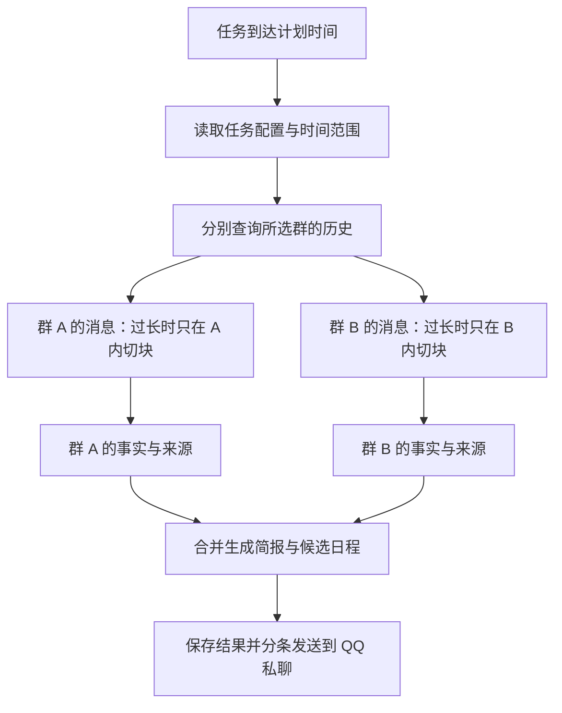

<div align="center">

# 多群每日简报

**把多个 QQ 群的重要通知整理成一份简报，再把你选中的日程加入 AstrBot「未来任务」。**

[](metadata.yaml)
[](https://github.com/AstrBotDevs/AstrBot)
[](#使用前准备)
[](LICENSE)

[安装](#安装) · [快速开始](#快速开始) · [页面与配置](#页面与配置) · [消息读取流程](#消息读取流程) · [日程与提醒](#日程与提醒) · [常见问题](#常见问题) · [详细说明](使用说明.md)

</div>

适用于 [AstrBot](https://github.com/AstrBotDevs/AstrBot) 的多群日报／周报插件。你可以创建多份任务，分别选择源群、模型、人格、提示词和执行时间，把课程、工作或社群通知定时汇总到指定 QQ 私聊。

**先预览，再启用；候选日程由收件人选择后创建提醒。** 插件复用 AstrBot 已保存的群历史、模型服务和原生提醒能力，管理页也复用 AstrBot 的登录与端口。

> 当前源码版本为 **v0.4.1**，日程自动识别改为仅按消息条数判断，并简化简报和清单展示。已通过 **AstrBot 4.29.4** 隔离接口检查；自动化回归和实机验收范围见[兼容性与验证](#兼容性与验证)。

## 功能概览

| 功能 | 你可以做什么 |
| --- | --- |
| 多份日报／周报 | 为不同源群、收件人和时间分别创建任务 |
| 按群理解消息 | 各群先独立提取，再合并简报；长群单独切块，每块都带群名、群号和平台标识 |
| 自定义内容与表达 | 选择模型与人格，用提示词指定关注事项、个人背景、分类和篇幅 |
| 专用管理页 | 分区配置、悬停帮助、明暗主题、窄屏适配、简报预览和执行记录 |
| 可核对的发送 | 长简报编号分条，逐条记录回执，支持核实未知结果和手动补发 |
| 自然语言选日程 | 默认自动识别询问送达后的 **前 3 条有效文字消息**，支持延迟回复与多轮追问 |
| 创建前查重 | 对照已有原生任务，同一事项明确匹配时复用，存疑时先询问 |
| 原生提醒管理 | 在 AstrBot「未来任务」管理提醒，在插件中查看关联及实际状态 |

## 使用前准备

- **QQ 连接**：AstrBot 已通过 OneBot v11（`aiocqhttp`）连接 QQ，机器人在线且已加入源群。已验证的接入方案为 NapCat。
- **群历史**：已开启 AstrBot 群历史记录；若启用了消息白名单，所选群须能进入消息处理流程。插件只能总结实际保存且尚未清理的消息。
- **模型**：在 AstrBot 中配置可用的聊天模型及有效的上下文上限。任务选择主模型，备用模型沿用收件人会话对应的 AstrBot 配置。
- **到期提醒**：收件人会话的原生模型和消息工具能够执行 AstrBot「未来任务」。简报生成与到期提醒的模型配置分别见[人格与模型](#人格与模型)。

当前支持 **QQ 群作为来源、QQ 私聊作为收件人**，不支持直接向群里推送简报，也未适配其他聊天平台。

## 安装

在 AstrBot WebUI 的「插件」页点击「安装插件」，选择「从链接安装」，填入以下仓库地址：

```text
https://github.com/WinterMoonlight/astrbot_plugin_daily_digest
```

安装后确认插件已加载，再从插件详情打开「多群每日简报」管理页。安装入口说明可参考 [AstrBot 官方插件文档](https://docs.astrbot.app/use/plugin.html)。

<details>
<summary>手动安装与升级</summary>

将源码放入 AstrBot 的 `data/plugins/astrbot_plugin_daily_digest/`，确保 `main.py`、`metadata.yaml`、`digest/` 与 `views/` 直接位于插件根目录。在 AstrBot 使用的 Python 环境安装 `requirements.txt` 中的依赖，再重载插件或重启 AstrBot。

升级前备份插件代码和 `data/plugin_data/astrbot_plugin_daily_digest/digest.sqlite3`。运行中的数据库使用 SQLite 一致性备份，或停机后复制。**v0.4.1 使用业务数据库版本 4**，会移除旧的回复计时字段并保留剩余条数；如需退回旧插件，请同时恢复对应版本的数据库备份，避免混用新状态和旧逻辑。

</details>

## 快速开始

1. 打开插件管理页，点击左侧「**新建任务**」。
2. 在「**消息与投递**」填写任务名称、选择源群，并填写私聊收件人 UMO。
3. 在「**内容与表达**」选择总结模型、可选人格，填写希望关注的内容；再设置运行计划和日程提醒参数。
4. 点击「**保存配置**」，到「**简报预览**」点击「**保存并生成预览**」，检查正文及「消息覆盖与生成信息」。预览会调用模型、可能产生费用，但不会发送 QQ 消息或创建提醒。
5. 回到「任务配置」点击「**启用任务**」。从下一个计划时点开始生成，完成后发送；可在「**执行记录**」查看进度和分条回执。
6. 如果简报包含候选日程，机器人会在简报成功发送后单独询问。回复要添加的事项，随后到 AstrBot「**未来任务**」或插件「**日程与提醒**」查看结果。

收件人须填写完整 UMO：让收件人私聊机器人发送 `/sid`，复制返回的会话标识，格式为 `平台实例:FriendMessage:QQ号`。群列表不可用时，可以展开「手动填写群会话标识」，每行填写一个 `平台实例:GroupMessage:群号`。格式中的占位文字须替换成实际值。

例如，为课程群创建每天 08:00 的任务，回看 24 小时，在总结提示词中填写：

```text
我是这些课程群的学生。优先整理与我有关的作业、考试、课程调整和报名截止时间。
按课程分类，保留明确的日期、时间、地点及来源群，合并重复通知，忽略闲聊。
时间或适用对象不明确时标注“待确认”，不要根据群名猜测我的身份。
```

## 页面与配置

管理页包含「**任务配置**」「**简报预览**」「**执行记录**」「**日程与提醒**」四个标签页。字段旁的 `?` 支持鼠标悬停、点击或键盘聚焦查看说明，按 Esc 关闭；页面适配明暗主题与窄屏。

### 每份任务独立配置

| 分区 | 配置 | 默认值或用途 |
| --- | --- | --- |
| 消息与投递 | 任务名称、消息来源、私聊收件人 | 一个或多个源群，发送到一个 QQ 私聊；已选群显示为可移除标签 |
| 内容与表达 | 总结模型 | 从 AstrBot 已配置的模型中选择 |
| 内容与表达 | 人格（可选） | 留空时沿用收件人的 AstrBot 会话人格 |
| 内容与表达 | 总结提示词 | 默认整理重要通知、待办、截止时间及变更；可补充关注范围与个人背景 |
| 运行计划 | 执行频率 | 默认每日；每周模式可选择一个或多个执行日 |
| 运行计划 | 执行时间、时区 | 默认 `08:00`、`Asia/Shanghai`；此时间开始生成，不保证在该时刻完成发送 |
| 运行计划 | 消息回看时长 | 新建每日任务默认 **24 小时**，新建每周任务默认 **168 小时**，可独立修改 |
| 日程提醒 | 默认提前量 | **30 分钟**；允许为 0，用户本次明确指定的时间优先 |
| 日程提醒 | 候选日期范围 | **7 天**，即今天及随后 6 天内尚未开始的事项 |
| 日程提醒 | 清单有效期 | 询问成功发送后 **24 小时**可补选；补选不续期，新简报会替换同一任务的旧清单 |

新任务默认停用。已登记执行使用当时的配置快照，后续修改用于后续计划。归档和彻底删除入口位于配置底部的「任务管理」。

### 所有任务共用的全局设置

点击页面右上角「**全局设置**」修改，保存后生效；取消关闭不保存编辑。

| 分区 | 设置 | 默认值 | 作用 |
| --- | --- | --- | --- |
| 生成与资源 | 同时生成上限 | **1** | 同时生成的任务数，其余排队 |
| 生成与资源 | 生成超时 | **1200 秒** | 一次生成的整体时间预算 |
| 生成与资源 | 生成调用预算 | **64 次** | 分块提取、压缩和最终汇总合计的逻辑模型调用上限 |
| 发送与记录 | 单条文字长度 | **1500 字符** | 长正文分条发送，含分条编号；最低 32 字符 |
| 发送与记录 | 分条发送间隔 | **1 秒** | 两次发送之间的等待时间 |
| 发送与记录 | 执行详情保留 | **30 天** | 清理符合条件的旧详情；未完成业务和必要防重凭据另行保留 |
| 回复识别 | 自动识别条数 | **3 条** | 从询问全部送达起累计计数，前几条有效文字可直接回复，不另设分钟限制 |

全局参数须为正整数。模型服务自身的重试与备用模型尝试不等同于这里的逻辑调用次数；预算不会保证固定费用。已在生成的任务使用启动该次生成时的设置；已登记的询问保留剩余条数，新条数设置用于后续询问。

### 人格与模型

- **总结正文与日程结果回执**：统一使用任务选定的人格；留空时，根据收件人当前会话及 AstrBot 配置解析人格。任务总结提示词中适用的语言、称呼和风格要求也会约束回执。
- **插件中的模型调用**：简报生成、日程意图解析及结果回执使用任务模型，备用模型沿用收件人会话配置。人格在每次准备调用时重新读取。
- **到期提醒**：创建后交给 AstrBot「未来任务」执行，使用收件人会话的原生模型、人格和消息工具配置。

结果回执始终保留事项、处理结果、事项时间、实际提醒计划及任务状态，并注明时区。回执的语气生成失败时使用固定格式返回事实，不会重新执行一次日程操作。

## 消息读取流程

### 每次读取哪些消息

插件按「**所选群＋原计划时点向前的回看范围**」查询 AstrBot 已保存的历史，不会每次把整个主数据库交给模型。

例如，每天 08:00 执行、回看 24 小时，就读取各选中群从**前一天 08:00（含）到当天 08:00（不含）**入库的消息。延迟执行或手动补发仍使用原计划范围；手动预览则以预览请求时刻为终点。

每次都会按范围重新查询，并非从“上次读到的位置”继续。每日执行但回看 48 小时时，相邻两次会有重叠；回看范围小于执行间隔时则可能有空档。筛选使用消息**入库时间**，回看时长也不决定 AstrBot 的历史保留时长。

### 按群提取，再合并



每一块从第一轮阅读起都带有**群名、群号、平台标识和完整 UMO**，帮助模型理解课程或组织背景；这些信息放在 JSON 外层，消息本身只保留来源编号、时间和正文。群内压缩与最终跨群汇总继续保留群标签。

这些标识用于模型理解与程序核对。面向收件人的正文要求自然提及群名，不逐条附上群号。程序不再追加逐群「覆盖说明」，详细读取统计保留在管理页；部分群读取失败时，最终生成会收到简短说明内容可能不全的要求。读取条数不代表采纳条数。

<details>
<summary>传给模型的数据结构示例（省略阶段和时间范围字段）</summary>

```json
{
  "group": {
    "name": "课程通知群",
    "id": "123456",
    "platform": "qq",
    "umo": "qq:GroupMessage:123456"
  },
  "messages": [
    {
      "id": "qq/17",
      "time": "2026-11-13T01:00:00+00:00",
      "text": "下周一下午三点举行课程说明会"
    }
  ]
}
```

这里的 `qq` 仅为示例平台实例 ID。群名称通过对应 OneBot 实例的群列表获取，每次生成每个平台查询一次；获取失败时保留群号并标记名称不可用。群名用于辅助理解，个人关系仍结合任务提示词和消息中的明确内容判断。

</details>

只有一个有文字内容的群且输入足够短时，直接生成最终简报，省去单独提取的一轮调用。多群或长消息会增加模型调用，仍受并发、超时和调用预算约束；减少重复群标签并不保证总 token 一定下降。可在「简报预览 → 消息覆盖与生成信息」查看各群消息数、分块数和调用数。

### 两个数据库分别负责什么

| 数据来源 | 保存内容 | 插件如何使用 |
| --- | --- | --- |
| AstrBot 主数据库中的群历史 | AstrBot 已记录且尚未清理的原始消息 | 通过 AstrBot 历史接口，按群和时间范围读取 |
| 插件数据库 `digest.sqlite3` | 任务配置、执行队列、简报结果、候选日程、提醒关联、发送回执和多轮追问状态 | 记录任务进度，支持重启恢复、补发核对及防重复处理 |
| AstrBot／OneBot 接口 | 群名称、模型、人格和原生未来任务等 | 按需读取元信息，创建或同步原生提醒 |

这两个数据库是独立的，**没有全量复制或主从同步**。原始群消息在生成时读入内存，不另行保存一份到插件数据库；插件会保存生成结果及处理交互所需的内容。插件数据默认位于 `data/plugin_data/astrbot_plugin_daily_digest/digest.sqlite3`。

为显示历史覆盖情况，还会统计选中群全部现存记录的条数、最早和最晚时间，但不会因此把全部消息正文送给模型。后台每 2 秒的队列与投递检查针对插件自身状态，不会每 2 秒重新读取群历史或调用模型。

## 日程与提醒

### 如何回复日程清单

以下为示例，名称与编号以实际清单为准：

新生成的 QQ 清单保留任务名称与事项序号，隐藏内部清单 ID。候选标题要求写清具体活动及签到、开始等时间节点；适用条件独立保存，相同条件在清单中只提示一次，并随选中的提醒保留。已发送的旧清单不会被改写。

```text
加入第 1、3 项
课程说明会提前一小时提醒我
/日程 把课程说明会改成明天下午两点提醒
/日程 取消课程说明会的提醒
```

| 规则 | 行为 |
| --- | --- |
| 自动识别 | 询问全部送达后，默认 **前 3 条有效文字消息**可自动判断是否为日程操作，不另设分钟限制 |
| 中间穿插闲聊 | 闲聊也消耗一条额度，但第一条闲聊不会直接关闭整个窗口；无关内容交回正常聊天 |
| 空文本或重复上报 | 不额外消耗有效消息额度 |
| 条数用完 | 停止自动识别；仍可引用有效清单或追问、带清单编号，或使用 `/日程` 明确操作 |
| 多轮追问 | 携带本轮用户请求和已送达的问题，可用“一小时”等短回答补充；新追问全部送达后重新计算条数 |
| 本轮结束或失效 | 完成、退出或关联事项失效后，不沿用旧追问上下文；重启不恢复已经用掉的条数 |

**自动识别条数与清单有效期是两回事。** 前者决定普通文字是否自动进入日程判断，后者决定这份清单还能不能补选。仅仅存在尚未到期的提醒，不会让后续所有聊天都调用日程解析模型；引用无关聊天也不会被接入最新清单。

例如 1 小时后才查看 QQ，只要本轮尚未结束、清单仍有效且前 3 条额度还有剩余，就可以直接回复；即使连续发送，第 4 条也不再自动识别。计数从询问送达开始，不是从打开 QQ 开始。条数用完后，尚有效的追问上下文仍保留供明确引用；完成、退出或相关日程失效后清理。

多份清单、同名事项或时间不明确时会先追问。未选择的候选不会自动建立提醒；群通知引起的改期或取消先询问确认，用户主动且明确的修改／取消请求则会执行并反馈。

### 已有任务如何查重

在调用原生创建接口前，插件重新读取同一收件人的现有任务，对照**事项时间和实际提醒时间**，按 UTC 的同一分钟匹配候选，并检查事项内容；周期任务也会检查目标时刻是否触发。

- **明确为同一事项、实际提醒时间相同，且是已启用的一次性任务**：直接关联已有任务，避免新建第二份。
- **内容不同或无法确定、提前量不同、任务停用、周期任务或多个候选**：先询问，再由你选择。
- 可以回复「复用第 1 个」「仍然新建」「放弃本次新增」，或在「日程与提醒」页面处理；仅回复「确认」不会默认新建。
- 确认前再次核对候选；候选已改变或删除时重新询问。

复用不会改写原任务的时间、说明、启停状态或归属。复用项在插件页只读，修改和取消请到 AstrBot「未来任务」。查重采用保守匹配，不保证识别所有语义相同的表述；其他入口若恰好在检查与创建之间同时新建任务，仍可能出现重复。

## 常见问题

<details>
<summary>为什么没有生成简报，或消息不完整？</summary>

先检查任务是否启用、QQ 与 OneBot 是否在线、机器人是否在群内，以及群历史与白名单设置。再查看「执行记录」和「消息覆盖与生成信息」，确认时间范围、各群读取结果和失败原因。所选范围内没有可用内容时，不会发送空简报。

插件只能读取 AstrBot 仍保留的消息。例如宿主每群仅保留 999 条，活跃群就可能不足一天；扩大回看时间不能找回已淘汰的记录。覆盖状态为“未知”不代表全天消息完整。

</details>

<details>
<summary>简报发送失败、结果未知或停机错过计划，如何补发？</summary>

在「执行记录」打开对应正式计划，查看逐条回执。明确失败的部分可手动补发，已成功分条不会重发。结果未知时先到 QQ 核实，再标记已发送／未发送；标记未发送后仍需明确提交补发。

遗漏计划或生成失败先「准备补发预览」，检查后再提交。日程询问可独立补发。停机遗漏不会自动批量补跑，重新生成使用原计划窗口中的现存历史，不保证恢复原稿。

</details>

<details>
<summary>提醒在哪里管理？原生任务消失就代表提醒成功了吗？</summary>

在 AstrBot「未来任务」管理每条提醒，在插件「日程与提醒」查看关联状态。到点由 AstrBot 原生模型与消息工具执行，插件不会再叠加一轮提醒发送重试。

名为「每日简报：任务调度」的任务只是分钟级的简报调度和状态同步入口，不是某一条事项提醒。原生一次性任务结束或被删除后都可能消失，**任务消失不等于 QQ 已送达**，请结合宿主日志和实际消息核对。

</details>

<details>
<summary>停用、归档、删除或卸载插件，会取消已有提醒吗？</summary>

停用、归档和卸载插件不会自动取消已有原生提醒。彻底删除须先归档，再勾选「显示归档任务」，进入「任务管理」核对删除范围并输入 `彻底删除`。

默认保留提醒，也可勾选取消该任务独有的提醒；共享提醒及复用的原生任务保留。删除会清理该任务的配置、执行记录、正文、候选清单及相关反馈，只保留必要的无正文防重凭据。已发出的 QQ 消息、AstrBot 原始群历史、宿主日志和既有备份不在删除范围内。

</details>

<details>
<summary>哪些内容会发送给模型？</summary>

生成简报时，所选群在对应时间范围内的可用消息、群标识及任务提示词会交给所配置的模型。日程意图解析会携带用户当前回复、关联事项及本轮必要追问上下文；结果回执也可能调用模型调整表达。请按所选模型服务的数据规则及你的消息处理权限使用。

当前主要处理文字、链接及非文本消息类型标记，不执行图片 OCR、附件内容解析或外部日历同步。摘要及日期识别仍可能遗漏或误解，请结合原消息核对。

</details>

## 近期更新

**v0.4.1：按条数识别与简报展示调整**

- 移除 5 分钟限制及对应设置，只保留可配置的自动识别条数，默认 3 条。
- 新追问送达后重新计数；条数用完停止自动识别，明确引用仍可使用尚有效的追问上下文。
- 同步日程询问文案与设置页帮助，清单有效期及已创建提醒保持原规则。
- 数据库升级到版本 4，移除旧计时字段，保留剩余条数和未完成上下文；已结束的旧询问不会重新开启。
- 调整程序内的表达约束，隐藏正文中的内部来源标识和清单 ID；移除机械覆盖统计，候选标题与适用条件分开。Web 中保存的用户总结提示词不自动改写。

**v0.4.0** 汇总了本轮功能及界面调整：

- **总结流程**：改为按群独立提取，长群单独切块；从首轮阅读到最终汇总持续传递群名、群号和平台标识，并校验消息来源。
- **日程交互**：自动识别默认 5 分钟、3 条，可在 Web 设置；支持夹杂闲聊、多轮补充和重启后的窗口状态恢复。
- **原生任务查重**：创建前核对同一收件人的已有任务；同项复用，存疑先问，确认前再次检查。
- **统一人格**：总结正文与日程结果回执使用任务选定的人格，留空时沿用会话人格；回执保留实际执行结果。
- **管理页面**：任务配置分为四个区域，全局设置独立弹窗；新增字段帮助、已选群标签、明暗主题、窄屏适配和键盘操作。

## 兼容性与验证

已验证环境：**AstrBot 4.29.4、Python 3.12.16、Ubuntu 24.04、Docker、NapCat**。这是一份实际测试环境记录，不是最低版本承诺。

| 验证范围 | 当前状态 |
| --- | --- |
| v0.4.1 自动化回归 | 165 项 Python 测试、29 项 AstrBot 4.29.4 隔离接口检查、5 项前端回归通过，包含旧计时字段迁移、消息条数、多轮追问、来源与适用条件保留、清单编号隐藏、并发和重启场景 |
| v0.4.0 自动化回归 | 152 项 Python 测试、29 项隔离原生接口检查、5 项前端回归通过 |
| 管理页交互 | 已检查配置与全局设置、帮助提示、键盘切换、明暗主题及窄屏布局 |
| v0.4.0 部署检查 | 已检查服务启动、页面资源、群列表读取和原配置保留 |
| 既有真实业务验证 | 早期版本已验证模型预览、定时私聊简报、自然语言选择及原生任务创建 |
| 仍需实机验收 | 新版自动识别、多轮追问和查重复用的完整 QQ 流程；真实多群质量、长内容投递、故障补发、带待处理状态的重启及实际提醒到期送达 |

隔离原生接口检查使用临时数据及模拟模型／消息客户端，不产生真实模型调用或 QQ 消息，不能替代真实到期提醒验收。

## 开发与反馈

详细操作与边界处理见[使用说明](使用说明.md)。欢迎通过 [Issues](https://github.com/WinterMoonlight/astrbot_plugin_daily_digest/issues) 反馈问题，附上插件／AstrBot 版本、复现步骤、预期与实际表现，以及去除凭据和私人消息后的必要日志。

<details>
<summary>源码结构与本地检查</summary>

| 路径 | 职责 |
| --- | --- |
| `main.py` | 插件生命周期、私聊入口与 Web API |
| `digest/adapters.py`、`digest/generation.py` | 宿主接口、群历史读取与分群总结 |
| `digest/storage.py`、`digest/workflow_store.py` | 独立数据库、执行记录与业务状态 |
| `digest/service.py`、`digest/runtime.py` | 生成队列、计划调度与分条投递 |
| `digest/dialogue.py`、`digest/interactions.py`、`digest/receipts.py` | 回复条数、多轮交互与结果回执 |
| `digest/native_reminders.py`、`digest/native_conflicts.py` | 原生任务关联、同步与创建前查重 |
| `digest/deletion.py` | 删除范围核对及数据清理 |
| `views/digest/`、`tests/` | 管理页与回归检查 |

在插件根目录，使用 Python 3.12 或兼容环境及 Node.js 执行：

```sh
python -m pip install -r requirements.txt
python -m unittest discover -s tests -p 'test_*.py' -q
node --test tests/test_view_bridge.cjs
node --check views/digest/app.js
node --check views/digest/ui.js
```

以上本地命令不包含 29 项宿主接口检查；后者见 `tests/native_probe.py` 与 `tests/build_native_bundle.py`，需要 AstrBot 环境。

</details>

## 致谢与许可证

基于 [AstrBot](https://github.com/AstrBotDevs/AstrBot) 的插件、群历史、模型与原生调度能力开发。文档组织参考 [AstrBot 插件模板](https://github.com/Soulter/helloworld/blob/master/README.md) 和 [LLM Balance 插件](https://github.com/XTsat/astrbot_plugin_llm_balance/blob/master/README.md) 的简介、使用示例及配置说明方式。

本项目采用 [MIT License](LICENSE)，Copyright (c) 2026 WinterMoonlight。允许使用、修改和再分发，需保留版权与许可声明；完整条款以 LICENSE 为准，依赖遵循各自许可证。
