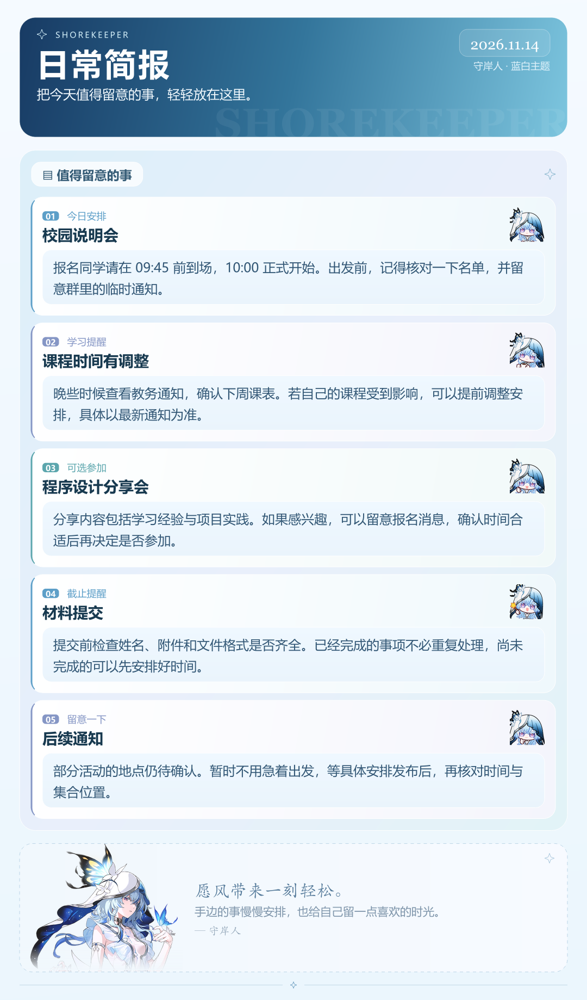

# 守岸人 · 蓝白简报模板

正式使用 Typst 本地排版，不需要浏览器或 AI 绘图。保留蓝白渐变、嵌套卡片、小型 Q 版表情、底部透明立绘和成组收尾短句。正文多时自然形成长图。

## 目录

| 路径 | 用途 |
| --- | --- |
| `template.json` | 模板规范版本 2，声明入口、宽度、图片、字体和收尾库 |
| `typst/report.typ` | 页面入口、字体与整体排版 |
| `typst/components.typ` | 页眉、卡片、外层面板、立绘收尾与装饰 |
| `assets/shorekeeper.webp` | 底部立绘，使用布局视窗截取上半身 |
| `assets/emotes/` | 用户提供的 12 张动图第一帧，静态 PNG |
| `assets/fonts/private/` | 私有字体，单独部署，不上传 GitHub |
| `copy/closings.json` | 10 组成对收尾文案 |
| `samples/` | 5 项标准、3 项长文、8 项加长示例 |
| `tools/extract-stickers.mjs` | 可选开发工具，重新提取动图首帧；依赖 Node 和 sharp，正式运行不使用 |

## 本地预览

在插件根目录安装依赖后运行：

```sh
python -m pip install -r requirements.txt
python tools/preview_template.py --template shorekeeper
python tools/preview_template.py --template shorekeeper --sample templates/shorekeeper/samples/extended.json
```

输出在 `.local/template-preview/preview.png`。使用正式渲染器，不调用模型、不发送 QQ。示例均为虚构内容。

模板使用原版微软雅黑、华文楷体和 Georgia，详见 [字体说明](assets/fonts/README.md)。缺少文件时尝试回退，无法找到声明角色的可用字体时回退文字输出。字体不随仓库分发；仅在部署服务器时单独复制到该模板的 `assets/fonts/private/`。

正式调用由数据库按收件人、模板和预览/正式计划记录短句选择，避免连续重复；同次执行及补发固定原图和文案。日程清单保持文字。

输出为 1080px 宽 PNG，字号保持不变，高度跟随内容增长；超出 12000px 或 8 MiB 时完整回退文字。每次编译在独立子进程完成，结束或超时后回收，不常驻。

[模板规范](../../docs/template-spec.md) · [素材来源](assets/SOURCES.md)



[查看加长示例](previews/extended-1.png)
