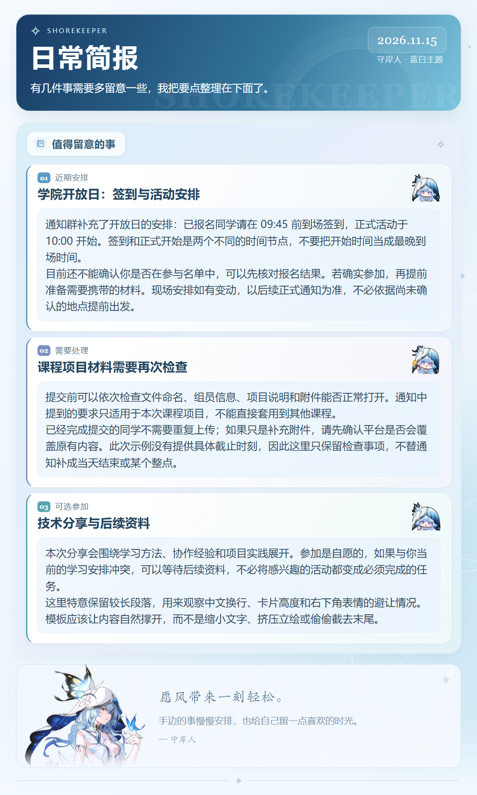

# 守岸人简报模板

模板已接入插件的图片输出、网页预览及发送队列。示例全部为虚构内容。规范见 [模板规范 v1](../../docs/template-spec.md)。正式运行使用 Python 渲染器，下面的 Node 工具保留为独立样稿开发入口。

## 拆分方式

| 文件或目录 | 职责 |
| --- | --- |
| `template.json` | 模板名称、画布宽度、预览窗口高度、组件清单和静态表情映射 |
| `template.html` | 页面骨架，不包含示例正文 |
| `components/background.html`、`styles/background.css` | 蓝白底色、海面线条、蝴蝶与星点 |
| `components/header.html`、`styles/header.css` | 标题、日期与简短开场 |
| `components/content-panel.html`、`styles/content-panel.css` | 包住全部事项的外层大面板、面板标题与内边距 |
| `components/card.html`、`styles/card.css` | 外层事项卡片、分类标签、标题区与独立的内层正文框 |
| `components/character.html`、`styles/character.css` | 底部轻量收尾卡：左侧半身立绘、右侧简短寄语与署名 |
| `components/sticker.html`、`styles/sticker.css`、`assets/emotes/` | Q 版尺寸、位置和首帧透明 PNG，按名称选择不同表情 |
| `components/footer.html`、`styles/footer.css` | 无文字的收尾细线、星形装饰和少量底部留白 |
| `styles/tokens.css`、`styles/page.css` | 颜色、字体、字号、间距及整页布局 |
| `../common/layout.js` | 将数据填入组件，按普通文档流向下延长，不分页 |
| `samples/` | 五事项标准示例、三事项长文示例、八事项加长示例 |
| `copy/closings.json` | 守岸人口吻的 10 组大字与小字收尾短句 |
| `tools/closing.mjs` | 随机挑选成组文案，并记录上一组以避开连续重复 |
| `tools/build.mjs` | 组合独立 HTML，内嵌图片、引用模板字体，无需网络 |
| `tools/render.mjs` | 使用无头 Chromium 截图并检查文字完整性 |
| `tools/extract-stickers.mjs` | 从用户提供的 WebP 动图逐个提取第一帧，保留透明度并核对像素 |

背景和卡片由 HTML/CSS/SVG 生成；Q 版使用用户提供的 12 个动图的第一帧 PNG。底部使用此前保存的 Wiki 透明立绘，通过 CSS 视窗展示头饰、面部和上半身，直接融入收尾卡底色，下缘渐隐，不修改素材本身。不会加载源动图，也不加载旧的 AI 表情图集。每份 HTML 只内嵌本次实际用到的表情，重复使用时共享相同图片地址。配色、卡片样式、立绘和表情可以分别替换。

当前布局为“浅蓝大面板 → 事项卡片 → 浅色正文框”三层结构。每张事项卡片上方放分类和标题，下方正文单独放入圆角框。64px 的 Q 版放在右上角标题区，正文无需为表情留出侧边空栏。顶部只保留一次“日常简报”主标题，去掉重复的英文简报标签。正文结束后是一张浅蓝虚线收尾卡，左侧放透明半身立绘，右侧放简短寄语；不重复标题。卡片后的细线和星形装饰收尾，页尾随正文自然延长。寄语从固定短句库成组随机选择，不调用 AI，不涉及插件提示词。

本版参考群聊日常分析插件的 ATRI 和 BlueArchive 渲染样图，调整为渐变封面、微软雅黑粗体主标题、冷色分区和编号标签；仍保持蓝白主色，不引入群活跃度等无关统计。参考链接见素材记录。

## 正式渲染器预览

在插件根目录运行 `python tools/preview_template.py`，结果在 `.local/template-preview/`；不调用模型、不发送 QQ。需安装根目录依赖，并准备 Chromium 或本机 Chrome/Edge。

## 独立开发工具

在本目录使用 Node.js：

```sh
npm install
npx playwright install chromium
npm run render:standard
npm run render:long
npm run render:extended
```

Windows 上已有 Chrome 或 Edge 时，工具会优先使用它们，不必再安装 Chromium。也可以用环境变量 `BROWSER_PATH` 指定浏览器，或用 `PLAYWRIGHT_MODULE_ROOT` 指向已有依赖目录。

只生成可双击打开的 HTML：

```sh
node tools/build.mjs samples/standard.json previews/standard.html
```

输出位于 `previews/`：可滚动的 HTML（私有字体通过相对路径加载）、单张完整 PNG，以及 `.checks.json` 检查结果。PNG 沿用 `-1.png` 文件名，但不再拆分第二页。渲染不会连接服务器，不调用模型，不发送 QQ 消息。文字排版优先读取本模板字体目录，缺少时回退系统字体：收尾大字与署名优先使用华文楷体，其次楷体；主标题恢复微软雅黑粗体，正文、卡片标题和收尾小字仍用微软雅黑。字体清单遵循 `../template.schema.json`，`fonts.faces` 指定文件与字重、`fonts.roles` 指定角色。原版字体保存在模板的 `assets/fonts/private/`，仅在明确部署时随模板单独上传到用户服务器，不随仓库分发；字体文件名和用途见 [字体说明](assets/fonts/README.md)，部署方式及回退规则见 [模板规范](../../docs/template-spec.md)。缺少原版字体时才回退到 Noto，排版可能变化。

重新提取表情（原始动图不会修改）：

```sh
node tools/extract-stickers.mjs "原始Q版表情包文件夹路径"
```

不传路径时，读取本项目外层目录的 `Q版表情包`。输出为 300×300 的单帧 PNG；`assets/emotes/manifest.json` 记录源文件名、SHA-256、原动画帧数、输出尺寸及像素一致性校验。12 个原动图合计约 8.60 MiB，首帧 PNG 合计约 1.94 MiB。此处是文件体积，实际运行内存需另行测量。

## 收尾短句轮换

`copy/closings.json` 中每条记录含稳定的 `id`、大字 `title` 和小字 `note`；修改时保持成组，每组语义相连。当前有 10 组，不依赖当天事项，也不暗示任务已完成。

每次构建 HTML 时，会从上一组以外的候选中随机选一组。记录保存在本模板的 `.cache/closing-state.json`，不同样例共用；已忽略此文件，不提交 Git。关闭并重启构建工具后仍能读取上次记录。已生成的 HTML 内嵌所选文案，刷新或重新截图不会换句。

上述 `.cache` 仅用于独立 Node 开发工具。正式流程由数据库按收件人、模板、预览/正式分别记录；同次执行固定选择。Node 工具的本地预览轮换：顺序构建且有两组以上时不连续重复；并行构建仅尽量避免重复，尚未实现插件按任务或收件人分别记录。删除缓存会重新开始；只剩一组时允许复用。缓存损坏会重新抽选，其他读写错误会报告。

可运行 `node --test tools/closing.test.mjs`，检查 100 次连续选择、状态重新读取、成组一致性及空库等边界。

## 数据格式

```json
{
  "title": "日常简报",
  "date": "2026.11.14",
  "intro": "把今天值得留意的事，轻轻放在这里。",
  "sections": [
    {
      "label": "今日安排",
      "title": "校园说明会",
      "body": "这里放简报正文。可以使用换行。",
      "expression": "idle"
    }
  ]
}
```

表情名称：`idle`（闲置）、`bin`（垃圾桶）、`hypnotize`（催眠）、`coffee`（咖啡杯）、`watermelon`（西瓜）、`drink`（饮料）、`sunglasses`（墨镜）、`shy`（害羞）、`sleepy`（工作小睡）、`thinking`（思考）、`thumbs_up`（点赞）、`magic`（魔法）。这里使用的均是原动画第一帧，第一帧没有出现的动作不会被补画。省略或无法识别时按顺序选择；旧样例名称通过 `stickerAliases` 兼容。

内容以纯文字写入，HTML 标签不会被执行。画布固定宽度为 1080px，高度由正文决定；900px 只是浏览器预览窗口高度，不是图片高度限制。正文框随内容增高，外层卡片和大面板也一起增长，标题较长时自行换行并与右侧 Q 版保持间距。保持原字号，不分页、不添加“续”，输出整个文档的长图；打开 HTML 可以向下滚动，查看 PNG 时由图片查看器负责缩放和移动。

## 当前验证

- 标准示例：1080×1916，五张卡片，单张图片。
- 长文示例：1080×1803，三张更高的卡片，验证换行与文字空间。
- 加长示例：1080×3016，八张卡片，单张长图，可滚动至页尾。正式渲染超过 12000px 或 8 MiB 时完整回退文字。
- 渲染工具检查：正文完整、无横向溢出、所有卡片位于外层面板内、收尾卡与页脚不覆盖正文、收尾立绘不与寄语重叠、正文与 Q 版避让、PNG 高度覆盖完整文档。
- 独立长段落压力检查：单段也可自然向下增长，特殊字符作为文字显示，表情缺省回退。
- 长标题与正文框检查：标题可换行，Q 版保持在独立标题列；正文位于内层框中，不与标题或表情重叠。
- 12 张表情：单帧、300×300、透明通道保留，解码后的像素与原动画首帧一致，原文件 SHA-256 未变；标准页只内嵌所用 5 张，长文页只内嵌所用 3 张。

素材来源与排版参考见 [assets/SOURCES.md](assets/SOURCES.md)，全部首帧缩略图见 [emotes.png](previews/emotes.png)。




[查看八事项完整长图](previews/extended-1.png)
