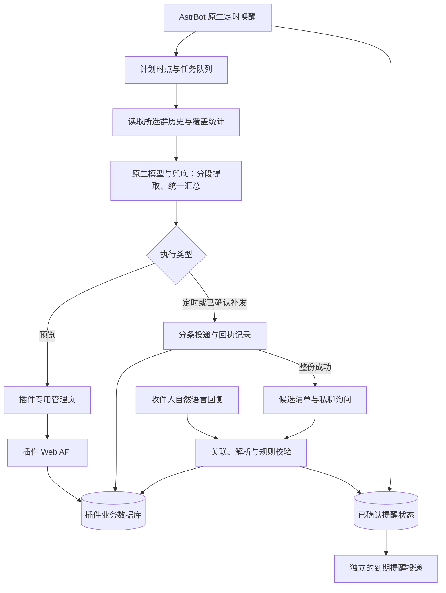

# AstrBot 多群简报插件整体开发方案

更新：2026-11-12。项目：`astrbot_plugin_daily_digest`。

**状态：用户已整体认可 B1–B7（含 B6 在插件关联提醒页管理）；关键接入路线已通过隔离验证，配置与预览开发里程碑已实现；完整首版仍在开发。尚未部署或进行真实模型/QQ 投递测试，详见 [接口验证报告](接口验证报告.md)。**

本方案以 [开发需求](AstrBot多群日报插件开发需求.md) 中的已确认决定为准。下文原“建议”已随本次整体方案获用户认可，作为实现基线；第八节保留决策明细，第九节列出仍需完成的技术验证门槛。主功能不再拆成连续的小问题。

## 一、首版交付范围

交付一个安装在现有 AstrBot 中的插件，包含 Python 后端、插件专用管理页和持久化业务状态。沿用 AstrBot 的模型、人格、群历史、OneBot 连接和定时能力，不新增账号体系或监听端口。

| 模块 | 已确认行为 |
|---|---|
| 管理页 | AstrBot Plugin Views；任务列表＋详情，配置、预览、执行记录、关联提醒分开查看 |
| 任务 | 多任务，不设固定总数上限；新任务保存后停用，手动启用后从下一计划时点执行 |
| 调度 | 每日/每周、分钟精度，默认 Asia/Shanghai；默认生成并发 1，其余排队，全局可改 |
| 消息 | 仅读取所选群的 AstrBot 历史；每日默认最近 24 小时、每周 7 天，每任务独立可改 |
| 生成 | 主模型每任务选择，兜底复用 AstrBot；输入过长分段提取、统一汇总；人格在每次执行时读取 |
| 简报 | 默认重要通知、待办与截止时间、变更与取消三类，空类省略；任务提示词可改；跨群合并并保留来源 |
| 覆盖 | 历史不足、部分群失败或覆盖未知时继续处理可用内容，发送时明确说明；无重要内容不发；全失败记异常 |
| 投递 | 仅指定 QQ 私聊，纯文本；长稿按事项/段落拆条、编号、依次发送；持久化防重，支持预览后补发 |
| 提醒 | 简报成功后询问，收件人自然语言选择才创建；默认提前 30 分钟、候选今天及随后 6 天、清单有效 24 小时，均每任务可改 |
| 记录 | 详细执行记录默认保留 30 天、全局可改；必要业务状态及防重凭据不跟随删除 |

提醒的关联、补选、跨任务去重、改期确认、明确指令直接执行及有限重试等规则，完整继承开发需求，不因本方案简写而省略。首版不增加独立原始群消息采集库、OCR、附件正文解析、外部日历或群内投递。

## 二、结构与职责

建议后端按职责划分，避免将全部逻辑塞入插件入口：

| 文件/模块 | 职责 |
|---|---|
| `main.py` | 注册插件、Web API、私聊事件处理、启动/卸载生命周期 |
| `domain.py`、`storage.py` | 配置校验、状态类型、SQLite 事务与迁移 |
| `history.py` | 群发现、按平台与群 UMO 读取历史、时间转换、覆盖报告 |
| `generation.py` | 输入预算、分段事实提取、跨段合并、简报与候选日程校验 |
| `adapters/model.py` | 主模型与 AstrBot 原生回退执行器接入、人格读取、实际模型记录 |
| `scheduler.py`、`queue.py` | 原生定时唤醒、计划时点、持久队列、并发控制、运行恢复 |
| `delivery.py`、`adapters/onebot.py` | 纯文本拆条、顺序发送、回执、成功/失败/未知分类 |
| `reminders.py`、`selection.py` | 候选清单、自然语言选择、去重、变更确认、到期投递 |
| `web_api.py` | 管理页接口，显式区分预览与投递操作 |
| `views/digest/index.html`、`app.js`、`style.css` | 任务列表、详情四区域及全局设置；静态资源随插件打包 |

使用插件自己的 SQLite 数据库保存业务状态，放在 AstrBot 插件数据目录中，具体路径通过框架接口获取并在部署验证时确认挂载持久性。无需额外数据库服务。后端状态唯一权威，不在浏览器另存一份任务配置。SQLite 操作串行化并避免长事务占用事件循环。

管理页建议直接使用本地静态 HTML/CSS/JavaScript 与 AstrBot bridge，不依赖公网 CDN。页面中的群消息和模型输出按文本渲染，防止其作为脚本执行。后端使用已存在的 AstrBot 登录和插件 API 权限，同时验证请求参数、任务归属和配置版本。

## 三、主执行流程

### 1. 保存、调度与排队

新任务保存后默认停用。必需配置包括任务名、源群、有效主模型、总结提示词、周期与时间、回看时长、私聊收件人；人格为可选。允许保存未完整草稿，但启用前必须完成校验（第八节 B1）。

启用后计算下一个计划时点。调度器只把到期任务登记进持久队列，不在定时回调中等待长时间模型调用。队列按计划时点排序，默认一个生成 worker；并发上限调整对后续领取任务生效，不强制中断已在运行的请求。

每次执行保存 `task_id`、计划时点、配置版本与窗口边界。默认数据库唯一键为 `(task_id, scheduled_at_utc)`，预览使用独立标识，不占用正式投递凭据。重试和补发仍关联原执行，不用新 ID 绕过防重。

任务越多越可能积压；列表展示排队与等待时间。不设固定总数上限不等于无限容量。排队不能防止 AstrBot 自身历史被持续清理，实际读取时的缺口必须报告，不能自动扩大原始消息保存范围。

### 2. 读取群历史

消息范围固定为 `[计划时点 - 回看时长, 计划时点)`；统一存储 UTC 时间，按任务时区展示。延迟或补发仍使用原窗口。周计划使用明确的星期名称映射，验证框架周日起点差异。

只从目标平台实例、目标群 UMO 读取；分页结果按稳定记录 ID 去重，按时间与 ID 排序。并发写入可能导致偏移分页漂移，优先核查可用的稳定快照/游标方式；若只能偏移分页，不能声称完全一致快照。

覆盖报告分开记录读取成功与否、条数、观察到的最早/最晚时间、已知缺口与未知原因。观察到的跨度并不证明期间没有遗漏。当前配置的每群 999 条不是硬上限；不修改宿主保留设置，不恢复已经删除的内容。

原始群消息只在本次处理内存中使用，不长期复制到插件库或日志。链接作为文字资料，不自动抓取网页；媒体只有类型占位符时就保留占位符，缺失文件名和正文不补造。入库时间并非可靠的原平台发送时间，这一限制在覆盖信息中说明。

### 3. 模型、长输入与输出校验

建议采用结构化事实中间层：事项、通知时间、事件时间、地点、截止时间、变更/取消标志、来源记录引用及不确定性。短输入可以一次生成简报与候选数据；长输入逐段提取后统一去重与整理，合并后仍过长则分层合并，不能直接截掉较早消息。

日期相对表达优先根据来源消息时间解析，而非一律套用当前日期；候选日期窗口再依据任务时区过滤。日期、事项指代或来源冲突时标为待确认，不编造确定安排。用户偏好的最终篇幅由提示词决定，中间事实保留足够证据，避免反复摘要造成早期细节消失。

主模型仍按任务选择。建议读取收件人 UMO 对应的 AstrBot 生效配置，复用其回退模型顺序与异常重试设置，未绑定会话配置时自然使用框架默认配置；此作用域已获确认（B1）。不建立插件备用模型配置，不把任务主模型替换成会话默认主模型。

普通 `llm_generate()` 不会自动加载回退链。建议在独立适配层使用原生 `ToolLoopAgentRunner` 的回退能力，传入通用上下文、空工具集、无副作用 hooks 和拒绝执行工具的执行器；不接入完整聊天主流程、不伪造 QQ 事件、不把简报写入日常聊天记忆。此路线已通过假 Provider 隔离验证（T1），真实模型联调仍待进行。

预算需同时考虑主模型与备用模型，预留系统提示词、人格、结构化数据和输出空间。回退模型窗口更小时，不能继续发送超过其容量的原请求；优先以整条回退链的最小已知窗口划分，未知窗口要求配置或明确显示限制。所有模型上下文上限都不是精确中文字符数。

群消息始终是资料。模型只返回文本和结构化候选，不直接拥有发消息、创建提醒或修改配置的工具。结构化输出须进行类型、来源引用、时间与长度检查；模型输出中的“执行指令”不能取代收件人的确认。

分段失败如何收尾、超时/调用预算见 B2，不把部分生成结果冒充完整简报。预览与正式生成使用同一管线，但预览根本不进入投递路径。

### 4. 投递与补发

生成完成后冻结本次正文及分条顺序，优先按事项和段落拆分；单事项仍过长时继续按句子/文本边界拆分，并保留编号。号码标记也计入长度预算。模型生成的 CQ 标记作为普通文本发送，不能被解释成额外消息操作。

投递前先持久化每一条的内容标识与状态，再通过 AstrBot 已有 OneBot 客户端发送到经过校验的私聊目标，记录协议回执消息 ID。不得同时走框架 send_message 和底层动作导致双发。`context.send_message()` 的 True 不能独立作为完整回执；OneBot 回执也只表示协议端确认，不证明用户已读。

每条至少区分 `pending / sending / acknowledged / failed / unknown`。发送后、落库前崩溃会留下不可消除的窗口；重启时将未确认的 sending 视为 unknown，阻止自动重发。方案不承诺端到端“严格恰好一次”。

整份简报全部分条获得确认后，才视为简报成功、替换同任务旧清单并发送新的日程询问。询问本身有独立投递状态，24 小时有效期从询问成功开始。简报已成功但询问失败，不回滚成“简报未发送”，也不把旧清单重新变为有效。

补发入口绑定原计划时点和固定消息窗口，先预览，再由管理页明确提交。已成功的分条不能再次发送；未知结果必须先核对；记录已清理且不存在原正文时，页面说明这是根据仍可读取的历史重新生成，不声称恢复原稿。详细处理建议见 B3。

## 四、提醒与原生定时的接入

### 已确认的交互保持不变

简报成功后在同一私聊列出候选事项。没有候选则省略询问。解析回复时只接收目标平台实例上指定收件人的私聊消息；优先引用消息 ID，再按明确任务/事项关联，多份清单有歧义则追问，不抢占无关日常聊天。

自然语言模型只输出“选哪个、如何提醒、是否修改/取消”的结构化意图。应用层检查清单有效期、替换状态、事件是否已开始、用户指定时间、已存在提醒及跨任务去重，再执行。识别不了就追问，不凭模型置信度越过明确关联规则。

同一收件人的同一事项和发生时间建立共享提醒及多来源关联。精确重复先按稳定引用匹配，语义相似仅用于提出候选，不能只凭同名合并不同日期或不同事项。改期/取消建立待确认变更，用户未回复就保留原提醒；明确的用户主动修改则按既有规则直接执行。

提醒发送仍按已确认规则：明确失败后每隔 1 分钟重试，最多额外 2 次；成功或事项开始即停止；未知结果不自动重发。与简报生成分离，不能等待长时间模型总结释放 worker 才投递提醒。

### 已采纳的调度实现（B6、T2）

使用 AstrBot `cron_manager.add_basic_job()` 注册本插件拥有的周期回调，按分钟检查持久化的计划简报与到期提醒。回调只领取工作并唤醒执行器，不能阻塞调度线程。单条提醒的日期、时刻、状态和重试次数在插件库保存，不将一次性提醒伪装为每年重复的 cron 表达式。

插件启动时通过 `list_jobs()` 识别带本插件专属归属标记的旧调度记录，清理残留并重建 handler；正常卸载时解除本插件调度器、停止 worker，业务数据保留。只处理本插件拥有的记录，不触碰用户其他定时任务。启动/重载重复注册、handler 丢失、回调重入均需专项验证。

这仍然复用 AstrBot 的定时触发，但**每条提醒主要显示在本插件的“关联提醒”页；AstrBot 原生定时任务页显示插件调度入口，不保证逐条显示提醒**。这是需要整体确认的呈现边界，不擅自将用户理解的“加入 AstrBot 定时”缩减。

不优先使用 Active Agent 一次性任务，是因为它会在触发时再次运行模型，难以直接约束固定内容、有限重试和未知结果处理。若用户需要原生任务页逐条可编辑，必须重新验证单条任务适配与修改同步，不能伪装已经支持。

## 五、数据与保留

建议使用带 schema version 的 SQLite 表，并通过事务保护关键状态转换。

| 数据 | 核心字段/用途 | 保留方式 |
|---|---|---|
| `tasks`、`task_versions` | UUID、版本、配置、启停、下个计划时点 | 当前配置保留；旧版本按引用清理 |
| `run_jobs` | 原计划时点、窗口、配置快照、队列/运行状态、租约 | 非终态必须保留；终态详情依执行记录期限 |
| `run_details` | 简报、覆盖统计、实际模型、错误与耗时 | 默认 30 天，全局可改 |
| `delivery_ledger`、`delivery_parts` | 执行唯一键、分条标识、状态、回执、未知结果 | 必要防重凭据独立保留，正文可按条件清理 |
| `candidate_lists`、`candidate_items` | 收件人、询问回执、有效期、替换关系、来源 | 有效清单保留，失效且无业务引用后可清理详情 |
| `reminders`、`reminder_sources` | 收件人、事项、发生/提醒时间、提前量、来源、状态 | 未完成提醒保留；跨任务共享关联 |
| `pending_changes`、`interaction_receipts` | 待确认变更、原消息去重、用户确认与操作结果 | 未处理变更保留，终态留最小审计与去重信息 |
| `plugin_settings` | 生成并发、执行记录保留期 | 不随日志清理 |

正式简报防重唯一键不包含配置版本：改提示词不能绕过已投递的计划时点。补发在原执行内操作；任务 UUID 不复用。提醒创建和用户消息重复投递也需数据库唯一约束，不能只依赖进程内集合。

多个 worker 或重启恢复通过短事务领取和租约防止同一工作被重复处理；网络调用在事务外执行。首版建议支持单个 AstrBot 实例及其多 worker，不宣称支持多个服务器同时共享数据库。

执行记录清理不级联删除业务状态。必要防重小记录包括对象 ID、计划时点、目标标识、内容哈希、发送状态及回执，尽量不保存完整原文。过期清单、终态提醒与保留中记录的清理次序见 B7。未知投递不得因为过了 30 天变成“从未发送”。

## 六、管理页与接口

任务列表显示启停、最近状态、下次计划、队列等待；全局设置包含生成并发和执行记录保留天数。任务详情四区：

1. **配置**：源群选择/手填、主模型、人格、提示词、周期、回看、收件人和提醒选项。保存与启用分开。
2. **预览**：展示采用的窗口、每群读取情况、生成结果、候选日程和实际模型；明确标识不会发送 QQ。
3. **执行记录**：分页查看、覆盖提示、失败原因、分条回执、未知结果与手动补发入口。
4. **关联提醒**：候选清单状态、已创建提醒、跨任务复用关系、待确认变更及失败记录。首版不因“可查看”自动扩大为任意编辑或批量删除。

API 按资源组织：任务 CRUD、启停、元数据列表（群/模型/人格）、预览任务、执行查询、补发确认、关联提醒查询、全局设置。耗时生成返回工作 ID，由页面查询状态；避免长 HTTP 请求直接占据页面连接。具体 URL 属实现细节。

群列表通过对应 AstrBot OneBot 客户端获取；列表失败时仍允许输入已知群号/UMO，并显示验证状态。多平台实例下不单凭 QQ 群号或用户号定位。私聊 UMO 必须校验消息类型，不能将群 UMO 当收件人。

模型密钥、服务器连接信息及完整宿主配置不返回前端。无需新建 API Key 输入框。页面不得静默触发投递，补发请求使用一次性确认标识与配置版本，重复点击只触发一个工作。

## 七、关键状态与一致性

生成状态建议为 `queued → reading → generating → ready`，另有 `empty / failed / cancelled`；投递单独为 `not_sent / sending / partial / acknowledged / unknown`。覆盖情况是独立字段，不用“成功”覆盖掉“不完整”。

候选清单区分 `awaiting_delivery / active / expired / superseded`；提醒区分 `scheduled / sending / retry_wait / acknowledged / failed / unknown / cancelled / missed`。待确认改期单独存储，不能先把原提醒标成取消。

关键事务包括：正式执行唯一登记；领取生成/投递工作；全部简报分条确认后更新投递状态并替换旧清单；用户消息去重与提醒创建；确认改期后更新提醒版本。外部调用与数据库无法形成一个原子事务，所以必须保留 unknown 状态及人工核对入口。

## 八、已确认的产品边界（B1–B7）

下表已获用户整体确认，不再逐项问询。

| 编号 | 边界 | 已采纳方案 | 影响 |
|---|---|---|---|
| B1 | 配置校验、模型兜底作用域、人格失效 | 草稿可保存但必需项无效不得启用；主模型配置失效记配置错误。回退链/原生重试取收件人 UMO 的 AstrBot 生效配置，未绑定时用默认；人格缺失时仅用任务提示词生成并显示警告 | 不另设兜底配置；人格丢失不会阻止简报，但语气会变化 |
| B2 | 分段失败、预算和预览排队 | 历史读取部分失败仍按已确认规则处理；模型任一必需分段/最终汇总失败则本次生成失败、不投递半成品。预览和补发共用生成并发上限，每任务同一时间只运行一个生成工作；不额外套一层整任务自动重试 | 避免无限重试和不完整模型处理被误报为覆盖不足；预览可能排队 |
| B3 | 分条失败、询问失败与补发 | 简报明确失败停止后续分条，保留成功部分，由用户预览后只补未成功部分；未知部分先核对再明确标记。询问失败单独补发，不重发已成功简报；没有证据不能自动判成功 | 提醒的“1 分钟、额外 2 次”不自动套到简报或询问；未知结果需要人工处理 |
| B4 | 重启错过计划时点 | 重启继续未来调度；持久队列中尚未发送的工作可恢复，sending 转 unknown。停机期间未登记的旧计划列为遗漏，默认不批量自动补发；错过的提醒若事项未开始，先询问如何处理，已开始则标记错过 | 避免重启后突发一串旧消息；历史补发不保证原始数据仍在 |
| B5 | 编辑、停用与删除任务 | 执行使用登记时配置快照，修改影响后续计划；停用/删除撤销未开始生成，并在下一外部动作前停止尚未发送部分；已发送不撤回。删除采用归档，不清除防重；此前创建的提醒仍保留，需独立取消 | 不把停止简报等同于撤销用户已选择的事项；运行中的请求可能完成但不继续投递 |
| B6 | 原生任务页呈现、过期交互与额外提醒 | 采用第四节原生周期调度入口，逐条提醒在插件页管理。失效清单回复说明失效并指向可用清单，不自动换序号；同一变更版本只询问一次。首版每事项保留一条有效提醒，“再加一次”澄清是否调整原提醒，不直接增加第二条 | 原生定时任务页不逐条列出提醒；多次提醒属于后续扩展，而非无声忽略用户请求 |
| B7 | 状态保留与候选日期基准 | 30 天仅清理终态详细记录，仍被未完成业务引用的数据延后清理；防重和必要归属标记独立保留。候选日期按实际准备发送时的任务时区“今天”过滤，询问前再排除已开始事项 | 少量必要状态可能超过 30 天；原消息回看仍锚定计划时点 |

建议参数起点，**已采纳为可调初值，尚未实测**：单条文本预算 1,500 字符（含编号），正常分条间隔 1 秒；单次生成整体耗时预算 20 分钟；最多 64 次逻辑模型调用（包括分段、合并和格式修复，不代表原生内部实际 HTTP 尝试次数）。将这些作为可调整的运行参数，若超预算则明确失败而非截断发送。模型超时与重试优先复用宿主设置，插件整体预算用于终止拖延任务；具体计数与取消能力需验证。未知上下文窗口不预设一个伪精确值，启用/预览校验明确提示缺失信息。

上述数字是工程起点，不是 QQ 平台限制或服务器能力实测结果。模型收费按真实模型请求产生，预览也会调用模型；日志显示逻辑调用数与可获取的 token 用量，不把无法获知的费用伪装成准确金额。

## 九、关键技术验证与上线门槛

| 门槛 | 要验证什么 | 通过标准/失败处理 |
|---|---|---|
| T1 原生模型兜底 | 通用上下文、空工具 Runner；主模型失败、备用成功、全失败、小窗口备用、取消 | 假 Provider 下可复现顺序、无聊天副作用；真实调用后续受控验证。若接口不满足，明确说明适配限制，不静默退回无兜底 llm_generate |
| T2 原生调度与恢复 | basic 回调重注册、插件重载、残留归属记录、到期提醒、分钟边界 | 同一到期事项只领取一次；无 handler 丢失、无重复定时器；关闭聊天 Agent 工具仍可运行。无法满足则回到技术方案，不能改成不透明的 Agent 自动操作 |
| T3 QQ 投递确认 | 已有 OneBot 客户端、纯文本与回执、异常与超时、分条长度 | 可获得 message_id 或明确错误；不确定时保留 unknown；确认接受与用户已读区分。实际长度与节流需真实私聊试跑 |
| T4 历史与页面 | 时间字段、分页一致性、多平台 UMO、Plugin Views 登录与接口 | 只读取选中范围，覆盖不能被误报；未登录无法操作，前端能调用自身插件 API |

源码检查支持“具备接入基础”，不等于上述测试已经通过。本轮隔离探针和开发预览测试结果见 [接口验证报告](接口验证报告.md)；T2 完整提醒恢复、T3 真实投递、T4 登录页面联调仍是后续验收门槛。实机与公开版本标签存在局部差异，适配层应核查接口能力并记录测试过的版本；不直接依赖不可见私有字典或 monkey patch 宿主来掩盖兼容问题。

## 十、实施顺序与验收

1. **兼容验证与骨架**：完成 T1/T2 的隔离验证、数据迁移骨架和接口能力检查。先验证关键路线，避免写完整 UI 后才发现接入不成立。
2. **管理页与历史预览**：实现任务 CRUD、启停、全局设置、源群/模型/人格选择和覆盖预览；预览无 QQ 副作用。
3. **生成与持久队列**：实现配置快照、计划窗口、并发控制、原生兜底、分段与合并。先使用合成消息验证，真实群内容仅在后续指定任务试跑时读取。
4. **投递与补发**：实现分条回执、防重账本、unknown 状态、手动补发及记录保留；通过故障注入验证数据库写入前后崩溃的差异。
5. **候选交互与提醒**：实现自然语言选择、清单生命周期、跨任务去重、变更确认、原生调度唤醒与提醒重试。
6. **受控部署**：备份插件业务库，先以停用任务安装和检查页面，再用指定群与私聊收件人完成预览、单次发送及重启验证；全部首版要求通过后才视为可用版本。

验收重点：

- 两个源群＋一个未选群，验证隔离、跨群重复合并、24 小时/7 天筛选及边界时刻。
- 默认并发 1、多个同时到点任务、调高/调低并发、预览与正式执行隔离、超时释放队列。
- 分段后的跨段改期/取消、长单条消息、备用窗口更小、模型全失败、结构化输出错误，不静默丢段。
- 多分条成功、明确失败、结果未知、发送成功后数据库写失败、重启与配置修改后重试，验证已确认部分不重发。
- 新简报替换旧清单、无候选简报、询问失败、24 小时过期、多清单歧义、补选、跨任务同收件人去重。
- 主动改期/取消、群通知需确认、提前量继承、时间已过需追问、明确失败重试两次、事项开始停止。
- 30 天清理不删除未完成提醒与防重；删除/停用任务行为按最终评审结果测试。
- Plugin Views 未授权访问、输出文本转义、跨收件人引用与模型提示注入不触发副作用。

每个阶段在 planning-with-files 三个文件记录结果，以本地 Git 检查点保存。部署验收对象尚需指定；本方案不意味着现在发送测试消息、开启任务或公开仓库。

## 十一、证据与当前限制

- [AstrBot Plugin Views 官方指南](https://docs.astrbot.app/dev/star/guides/plugin-pages.html)：插件页面目录、bridge 及 Web API 入口。
- [AstrBot Context 源码](https://github.com/AstrBotDevs/AstrBot/blob/v4.29.4/astrbot/core/star/context.py)：模型接口与主动发送入口；实机相应实现已只读核查。
- [AstrBot 原生 Runner 源码](https://github.com/AstrBotDevs/AstrBot/blob/v4.29.4/astrbot/core/agent/runners/tool_loop_agent_runner.py)：回退参数与执行流程，不能等同于插件普通接口自动继承。
- [AstrBot CronManager 源码](https://github.com/AstrBotDevs/AstrBot/blob/v4.29.4/astrbot/core/cron/manager.py)：basic handler 生命周期及 active agent 的区别。
- [OneBot v11 私聊发送规范](https://github.com/botuniverse/onebot-11/blob/master/api/public.md#send_private_msg-发送私聊消息)：私聊动作及消息 ID 响应。
- 实机检查位置、历史限制及未完成验证详见 [findings.md](findings.md)。本轮未输出服务器地址、密钥、API Key 或实际群聊正文。

用户已确认整体方案；当前先做兼容验证，通过后实现。技术验证失败时给出具体证据和备选方案，不重新开启无边界的逐项问卷。
